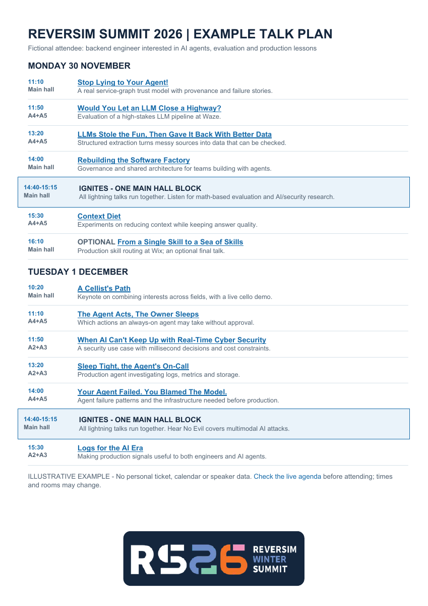

# Reversim Summit 2026 planner

A reusable agent skill that helps an attendee choose between parallel talks at Reversim Summit 2026 and creates a one-page plan by default. It reads the [live summit agenda](https://summit2026.reversim.com/agenda) through the summit's public, read-only MCP. No account or API key is needed.

## Example one-pager

This example uses a fictional attendee and public talk details. It contains no personal ticket, calendar, or speaker information. The logo comes from the [official summit site](https://summit2026.reversim.com/). [Open the example PDF](examples/example-one-pager.pdf).

## Use it

Install this repository as a skill in your AI assistant, or ask your assistant: **"Install the skill from `https://github.com/shmulc8/reversim-summit-2026-planner` and use it to plan my Reversim Summit talks."** The skill file is at the repository root.

Then say something like:

> I'm attending both days. I work on backend systems and AI agents, and I like talks with real experiments. Help me choose between parallel sessions and make a one-page itinerary.

The skill will ask for any missing preferences, compare full abstracts, check overlaps, and treat each Main Hall Ignites session as one block. It creates a one-page PDF when the assistant can make files, or a one-page plan in chat otherwise. If your assistant has access to your calendar or ticket email, you can ask it to account for those too.

The included Python helper calls the summit MCP directly when the assistant does not already have the MCP connected. It uses only Python's standard library and does not change your assistant's configuration.

## Scope

This skill is for the November 30-December 1, 2026 event. The agenda can change, so plans should be refreshed against the live source before the conference.
